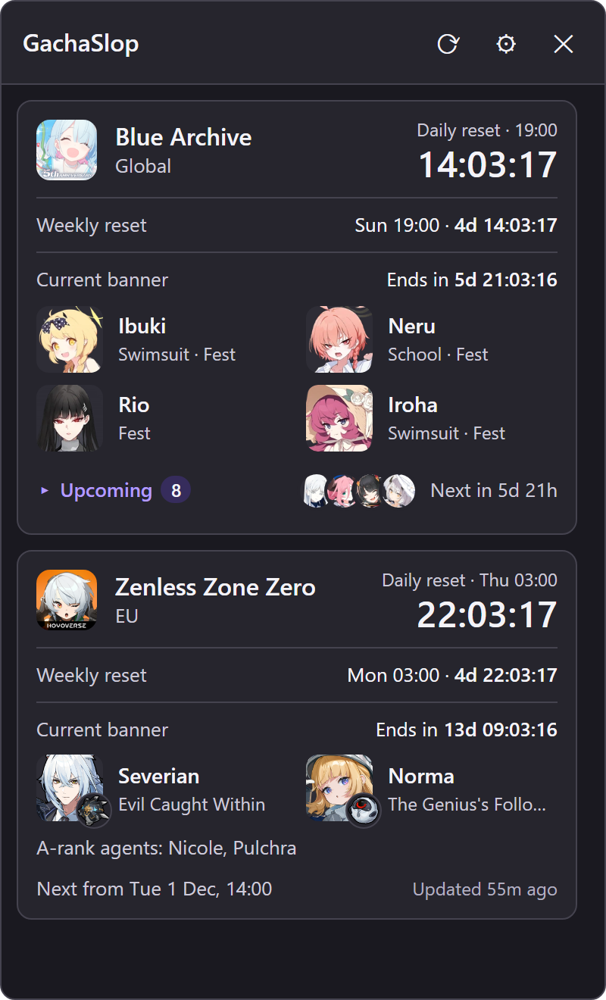
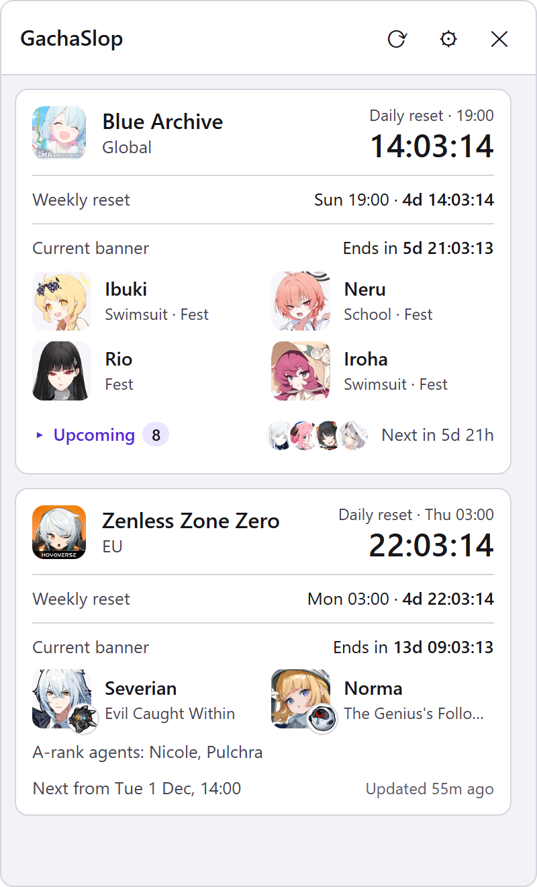
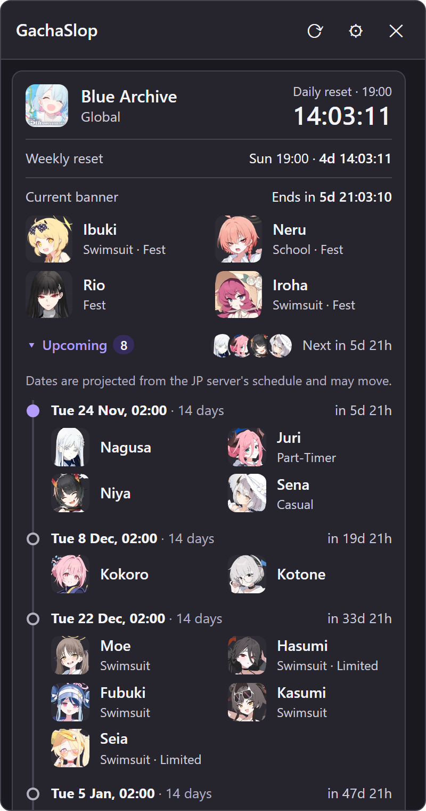
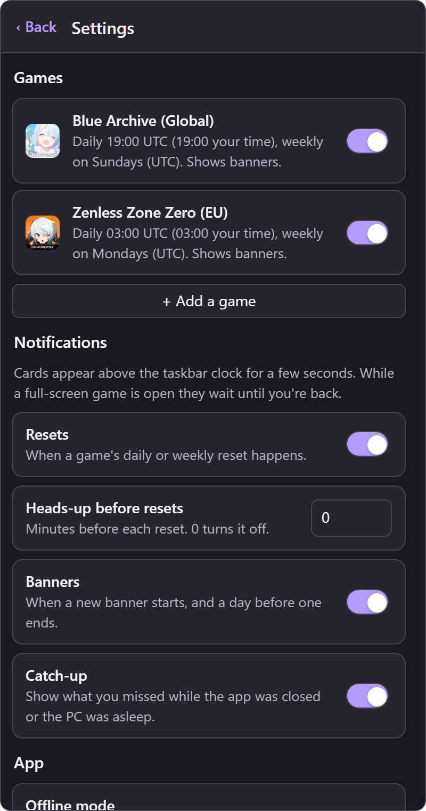
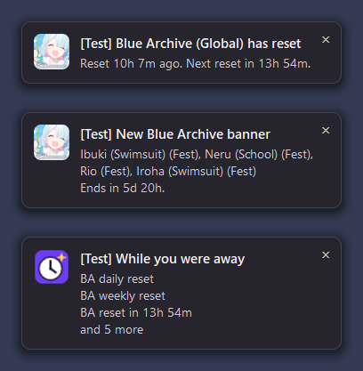
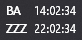

# GachaSlop (tray app)

A small Windows app that counts down to game resets and shows the current and upcoming banners for Blue Archive and Zenless Zone Zero. It sits on the taskbar next to the clock, showing the next two resets (`BA 02:15:07`, `ZZZ 10:15:07`); click it for the popup, right-click for the menu. Small cards pop up above it when a game resets or a banner goes live.

<table align="center">
  <tr>
    <td align="center"></td>
    <td align="center"></td>
    <td align="center"></td>
    <td align="center"></td>
  </tr>
  <tr>
    <td align="center"><sub><b>Resets and banners</b></sub></td>
    <td align="center"><sub><b>Light mode</b></sub></td>
    <td align="center"><sub><b>Upcoming timeline</b></sub></td>
    <td align="center"><sub><b>Settings</b></sub></td>
  </tr>
</table>

<table align="center">
  <tr>
    <td></td>
    <td width="300">
      <b>Notification cards</b><br>
      <sub>Appear above the taskbar widget (or beside the popup) and fade after a few seconds. Several at once become one card. These were made with the Testing buttons in Settings, hence "[Test]".</sub>
      <br><br>
      <b>On the taskbar</b><br>
      <br>
      <sub>Just left of the clock: the next two resets. Click for the popup, right-click for the menu.</sub>
    </td>
  </tr>
</table>

<p align="center"><sub>Screenshots taken on 18 November 2026 with the banner data stored at the time.</sub></p>

## Features

- **Taskbar widget:** the two soonest resets, ticking as HH:MM:SS, drawn on the taskbar just left of the clock (the same idea as [Wireless Battery](https://github.com/krisgfx9/Wireless-Device-Battery-Monitor)). With several screens, every screen's taskbar gets its own copy, left of that taskbar's clock, so the countdowns stay in view while a game runs full screen on another screen; clicking one opens the popup on that screen. It follows the taskbar's light or dark theme, shows a red dot when there's something you missed, and comes back by itself if Explorer restarts or a screen is plugged in. If the taskbar is vertical or set to auto-hide, a tray icon is used instead.
- **Game cards:** one card per game with its daily and weekly countdowns (HH:MM:SS) and, for Blue Archive (Global) and Zenless Zone Zero (EU), the current banner with character icons. Each Zenless Zone Zero agent carries its signature W-Engine as a small badge on the corner of its icon (hover either for names). Blue Archive's Fest, Limited and Free pulls marks are written out under each student. Upcoming banners are in a dropdown, so both games fit without scrolling. Every time is kept in UTC and shown in your PC's own time zone.
- **Notification cards** for resets, an optional heads-up before them, new banners and banners ending within a day. The app draws these itself rather than using Windows notifications: a card with the game's icon appears above the taskbar widget (or beside the popup while it's open) and fades after a few seconds. Hover to keep it, click to open the popup, × or right-click to close it. While a full-screen game or presentation is in front, cards wait and then show together as one.
- **Catch-up:** anything that happened while the app was closed or the PC was asleep is shown when it next starts. Several at once become one summary card, and the widget shows a red dot until you've opened the popup.
- **Notifications list:** every notification that came in is kept for 30 days. The newest unread ones are listed at the top of the popup (once read, just the latest in one line); click it, or the bell, for the full list, grouped by day and newest first, with what was missed while the app was closed marked.
- **Your own games:** add any game with an icon, a name and its reset time in UTC (plus an optional weekly reset day); the form shows what that is in your time. Added games get reset notifications but no banners.
- **Works offline:** banners and icons are stored locally. Offline mode (Settings or the tray menu) stops all network requests.
- **Start with Windows** (optional): starts hidden in the tray.
- **Updates, only when you say so:** once a day (or with Check now in Settings) the app asks GitHub whether there's a newer release and, if so, shows a banner. Install update downloads the new installer, checks it's exactly the file GitHub lists (size and SHA-256) and updates in place with just a progress window; GachaSlop closes and opens again by itself. Nothing is ever downloaded or installed without you choosing to, the daily check can be switched off, and you can always download the installer yourself instead.
- **Testing** (bottom of Settings): show any kind of notification card now (marked [Test]), replay catch-up as if you'd just come back, switch to the tray icon to try the fallback, see how the widget is shown, and open the data folder or log. None of it uses the network.

Built-in games:

| Game | Server | Daily reset | Weekly reset |
|---|---|---|---|
| Blue Archive | Global | 19:00 UTC | Sundays 19:00 UTC |
| Zenless Zone Zero | EU | 03:00 UTC (04:00 server time) | Mondays 03:00 UTC |

Notification cards say how long ago or how long until ("Reset 3h ago", "Ends in 6d 0h"); the popup shows clock times in your time zone.

## Network use

The app makes as few requests as possible. Banner lists are stored and only fetched again when the stored data runs out:

- **Blue Archive:** future banners are projections from the JP schedule, so the list is checked once as each one is due to start, and its "new banner" notification waits for that check. About 2 to 4 requests a month.
- **Zenless Zone Zero:** the source only lists the current phase, so it's checked once when that phase ends. If the new phase isn't listed yet, it tries again after 30 minutes, 2 hours, 6 hours, then every 12 hours.
- **Icons** are downloaded once per character and deleted when no stored banner uses them.
- **Refresh banners** does nothing if the lists were fetched in the last 5 minutes.
- **Updates:** one request to GitHub a day to see if there's a new version (no sooner than 10 minutes after starting; can be switched off). The installer is only downloaded when you choose Install update.

Nothing is fetched at startup, on waking, or on opening the popup. Offline mode stops all of it, update checks included. Settings shows the number of requests this month.

## Where things are kept

`%APPDATA%\com.gachaslop.app`: `settings.json`, `state.json` (notifications already shown, the notifications list, request count), `games.json` (your games), `banners.json`, `icons\` and `game-icons\`. Logs are in `%LOCALAPPDATA%\com.gachaslop.app\logs`.

## Packages

Kept to a minimum. Rust uses only `tauri`, `serde`, `serde_json` and `windows-sys` (for the taskbar widget and notification cards; Tauri already builds it, so it adds nothing new). Everything else is the app's own code or a tool built into Windows:

- downloads go through Windows' `curl.exe` (Windows 10 1803 and later), and update downloads are checked with Windows' `certutil.exe`;
- the taskbar widget and notification cards are drawn with Windows' GDI and GDI+ (which also reads the game icons);
- "Start with Windows" is a `HKCU\...\Run` entry written with `reg.exe`;
- dates, logging, the one-copy-at-a-time check (a local port, 47613) and popup placement are small modules in `src-tauri/src`.

The popup uses Svelte and Vite. Tests need no extra packages.

## Building and testing

Needs Rust (MSVC toolchain), Node.js and the Visual Studio C++ build tools. In Windows PowerShell, use `npm.cmd` if script running is disabled.

```
npm install
npm run tauri dev      # run with live reload
npm run tauri build    # installer in src-tauri\target\release\bundle\nsis
npm test               # popup time formatting (Node's built-in test runner)
npm run check          # popup type check
cd src-tauri && cargo test
```

### Building on GitHub

[.github/workflows/build.yml](.github/workflows/build.yml) builds on a GitHub Windows machine (tests first, then the installer), but only when asked, to save Actions minutes:

- **Release:** set the new version in `src-tauri/tauri.conf.json` (`"version"`), commit and push, then tag it: `git tag v0.2.0` and `git push origin v0.2.0`. A GitHub Release named "GachaSlop v0.2.0" appears with the installer (`GachaSlop_0.2.0_x64-setup.exe`) and the plain `.exe`.
- **Test build:** Actions tab, "Build", "Run workflow". The files are attached to that run as artifacts.

The installer isn't code-signed, so Windows SmartScreen warns the first time it runs ("More info", then "Run anyway").

Rust tests are in `src-tauri/src/tests/` (inside the crate so they can reach its private modules), with sample API responses in `src-tauri/fixtures/`. JavaScript tests are in `tests/`.

The app ships its own Windows manifest (`src-tauri/windows-app-manifest.xml`, used by `build.rs`): Tauri's default plus Windows 8+ compatibility, without which Windows won't draw the taskbar widget.

## Data sources

All unofficial; banner information may occasionally be missing or late.

- Blue Archive banners: [ba.joexyz.online](https://ba.joexyz.online) ([source](https://github.com/jozsefsallai/ba-tools)). Student icons: [SchaleDB](https://schaledb.com).
- Zenless Zone Zero banners and icons: HoYoLAB's gacha calendar through [api.ennead.cc](https://github.com/torikushiii/hoyoverse-api). Its times are for the Asia server, so they're moved to EU server time, assuming banners change at the same local time on every server.
- Game icons for Blue Archive and Zenless Zone Zero: their App Store icons (NEXON Korea and COGNOSPHERE), included in the app.
